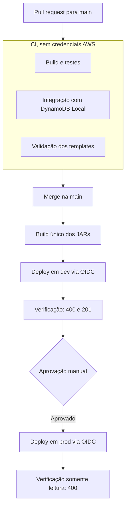

# Deploy e CI/CD — Tarefa 6

## 1. Visão geral

Todo PR é validado sem acesso à AWS. Depois do merge, a pipeline compila os artefatos uma única vez, publica em `dev`, verifica a API e aguarda aprovação manual para publicar os mesmos artefatos em `prod`.



## 2. Decisões e justificativas

| Decisão | Justificativa |
|---|---|
| AWS em modelo serverless (FaaS) | Cobrança por uso, adequada a créditos limitados. Sem servidores para administrar. |
| AWS SAM como IaC | Sintaxe própria para Lambda, API e eventos. Permite testar localmente com os mesmos templates. |
| GitHub Actions | O repositório já está no GitHub, sem integração adicional. |
| Ambientes `dev` e `prod` | Isolam testes de produção. Os 8 alarmes dos dois ambientes cabem nos 10 gratuitos do CloudWatch. |
| Build único | `prod` recebe exatamente os JARs testados em `dev`. |
| Autenticação OIDC | Não há chaves de longa duração para vazar. As credenciais duram apenas uma execução. |
| Aprovação manual em `prod` | Nenhuma mudança chega à produção sem decisão explícita. |
| Rollback do CloudFormation | Uma falha no deploy desfaz a alteração, sem a complexidade de canary. |
| Stack de bootstrap separada | Recursos únicos por conta não podem se repetir nas stacks de cada ambiente. |
| SES em sandbox | Remetente e destinatário verificados bastam para a demonstração. |

## 3. Componentes

| Componente | Função |
|---|---|
| `infrastructure/bootstrap.yaml` | Base da conta: OIDC, role de deploy, bucket de artefatos, identidades SES, role de logs do API Gateway e alerta de custo |
| `infrastructure/template.yaml` | Aplicação: API, funções, tabela, tópico, alarmes e dashboard |
| `infrastructure/samconfig.toml` | Perfis `dev` e `prod`, cada um com sua stack |
| `.github/workflows/ci.yml` | Validação de PRs |
| `.github/workflows/deploy.yml` | Build e sequência de ambientes |
| `.github/workflows/deploy-environment.yml` | Deploy e verificação de um ambiente |
| `scripts/smoke-test.sh` | Verificação da API publicada |
| `scripts/setup-github.sh` | Configuração inicial do GitHub |

## 4. Passo a passo da configuração inicial

Estes passos são feitos uma única vez.

### 4.1. Aplicar o bootstrap na AWS

1. No Console AWS, selecione a região `us-east-1` e abra o **CloudShell**.
2. Envie o arquivo `infrastructure/bootstrap.yaml` pelo menu **Actions > Upload file**.
3. Execute, trocando os e-mails:

```bash
aws cloudformation deploy \
  --template-file bootstrap.yaml \
  --stack-name fiap-tech-challenge-fase-4-bootstrap \
  --capabilities CAPABILITY_NAMED_IAM \
  --parameter-overrides \
    AdminEmail=seu-admin@email.com \
    SenderEmail=seu-remetente@email.com \
    MonthlyBudgetUsd=10
```

4. Anote os valores gerados:

```bash
aws cloudformation describe-stacks \
  --stack-name fiap-tech-challenge-fase-4-bootstrap \
  --query "Stacks[0].Outputs" --output table
```

5. Clique nos links de verificação que o SES envia para os dois e-mails.

### 4.2. Configurar o GitHub

Com permissão de admin no repositório, execute na raiz do projeto:

```bash
bash scripts/setup-github.sh <DeployRoleArn> <ArtifactBucketName> seu-admin@email.com seu-remetente@email.com
```

O script cria:

| Item | Onde | Valor |
|---|---|---|
| `AWS_DEPLOY_ROLE_ARN` | Variável do repositório | Output `DeployRoleArn` |
| `ARTIFACT_BUCKET` | Variável do repositório | Output `ArtifactBucketName` |
| `ADMIN_EMAIL` | Secret de `dev` e `prod` | E-mail dos administradores |
| `SENDER_EMAIL` | Secret de `dev` e `prod` | E-mail remetente |
| Aprovadores de `prod` | Environment `prod` | Lucas e Marcelo |
| Validações obrigatórias | Branch `main` | Os três jobs do CI |

### 4.3. Depois do primeiro deploy

Cada stack cria uma inscrição no SNS. Confirme os dois e-mails de **AWS Notification - Subscription Confirmation** para receber os alertas.

## 5. Uso no dia a dia

1. Abra um PR para `main` e aguarde as três validações.
2. Faça o merge. O deploy em `dev` começa automaticamente.
3. Em **Actions > Deploy**, clique em **Review deployments** e aprove `prod`.

Para publicar de novo sem alterar código, use **Actions > Deploy > Run workflow**.

### Verificação pós-deploy

| Ambiente | Requisição | Resposta esperada |
|---|---|---|
| `dev` | Payload inválido | 400 |
| `dev` | Avaliação válida com nota 10 | 201 |
| `prod` | Payload inválido | 400 |

A nota 10 tem urgência `BAIXA` e não gera e-mail crítico. Em `prod` nada é gravado, para não afetar o relatório semanal.

## 6. Segurança e governança de acesso

- **Quem pode publicar:** a role aceita somente os Environments `dev` e `prod` deste repositório. PRs não têm acesso à AWS.
- **O que pode ser publicado em `prod`:** apenas a branch `main`, com aprovação de Lucas ou Marcelo.
- **O que a pipeline alcança:** somente as stacks da aplicação e recursos com prefixo `dev-` ou `prod-`. A stack de bootstrap fica fora do alcance dela.
- **Dados:** a pipeline só tem permissões de plano de controle no DynamoDB, sem leitura ou gravação de avaliações.
- **Actions de terceiros:** fixadas por SHA do commit.
- **Dados pessoais em logs:** os e-mails são secrets e ficam mascarados nos logs públicos.
- **Abuso e custo:** a API tem limite de 10 requisições por segundo e pico de 20, ajustáveis por parâmetro. O alerta de custo avisa em 80% e 100% do limite mensal.

### Limitações conhecidas

- Alguns serviços não permitem restrição por nome. O API Gateway usa IDs gerados, e ações como `lambda:CreateEventSourceMapping` e `logs:DescribeLogGroups` usam recurso `*`.
- A pipeline precisa criar políticas inline nas roles `dev-*` e `prod-*`, porque o template as define. A anexação de políticas gerenciadas, por outro lado, é limitada a `AWSLambdaBasicExecutionRole`.
- O endpoint `POST /avaliacao` é público e sem autenticação, porque o desafio não a exige. O throttling reduz o risco de abuso.

## 7. Falhas e rollback

| Situação | Comportamento | Ação |
|---|---|---|
| Falha em uma validação do PR | O merge fica bloqueado | Corrigir no PR |
| Configuração ausente no GitHub | O job falha antes de acessar a AWS e indica o item ausente | Rodar `scripts/setup-github.sh` |
| Erro durante o deploy | O CloudFormation desfaz as alterações | Consultar os eventos da stack |
| Falha na verificação em `dev` | `prod` não é liberado | Reverter ou corrigir o código |
| Falha na verificação em `prod` | O job falha e a versão continua publicada | Reverter o commit e publicar novamente |
| Permissão negada na role de deploy | O deploy falha com `AccessDenied` | Ajustar `bootstrap.yaml` e reaplicá-lo |

## 8. Execução manual

Para publicar sem a pipeline, com credenciais AWS configuradas:

```bash
mvn clean package -DskipTests
cd infrastructure
sam deploy --guided
```

Para remover um ambiente:

```bash
sam delete --stack-name fiap-tech-challenge-fase-4-dev --region us-east-1
```

## 9. Roteiro do vídeo: trecho de DevOps

| # | Mostrar | Dizer |
|---|---|---|
| 1 | `template.yaml` e `bootstrap.yaml` | A infraestrutura é código, e recursos únicos da conta ficam separados dos ambientes. |
| 2 | Página **Environments** no GitHub | `dev` é automático. `prod` exige aprovação e só aceita a `main`. |
| 3 | PR com as três validações verdes | Nada é integrado sem build, testes e templates válidos, e PRs não têm acesso à AWS. |
| 4 | Execução de **Actions > Deploy** | Os JARs são gerados uma vez e promovidos entre ambientes. |
| 5 | Etapa **Verificar API publicada** | A pipeline comprova que a API responde depois do deploy. |
| 6 | Tela de aprovação de `prod` | A promoção é uma decisão humana e rastreável. |
| 7 | Role de deploy no IAM, com a relação de confiança | Não existem chaves guardadas. Só este repositório pode assumir a role, com permissões limitadas. |
| 8 | Stacks `dev` e `prod` no CloudFormation | Os ambientes são isolados e reproduzíveis. |
| 9 | Funções Lambda com `dev-` e `prod-` | As três funções foram publicadas pela pipeline. |
| 10 | `POST /avaliacao` com nota baixa e o e-mail recebido | O fluxo completo funciona na nuvem. |
| 11 | Throttling no API Gateway e AWS Budget | Há proteção contra abuso e controle dos créditos. |
