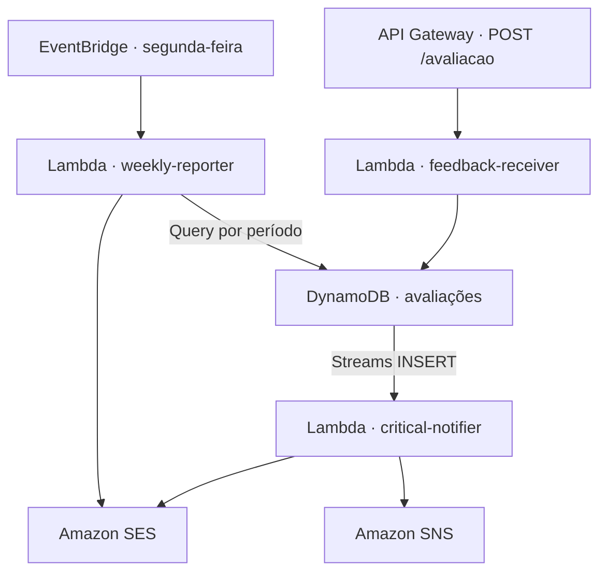

# Arquitetura e modelo de dados

[Voltar ao README](../README.md)

A solução usa serviços gerenciados da AWS para executar o processamento sob demanda. O fluxo HTTP termina após a persistência. O alerta e o relatório são processados por funções acionadas por eventos.

## Componentes Java

Os três módulos Lambda adaptam eventos da AWS a casos de uso em `common`. Esse módulo concentra DTOs, validações, regras de urgência e agregação, interfaces de persistência e envio e o adaptador DynamoDB. Os adaptadores HTTP, de métricas, de Streams e de envio ficam nos módulos que os utilizam. O pacote base é `br.com.fiap.techchallenge.fase4`.

## DynamoDB

| Atributo | Tipo | Uso |
|---|---|---|
| `id` | String | Chave primária, UUID gerado no recebimento |
| `descricao` | String | Texto da avaliação |
| `nota` | Number | Nota entre 0 e 10 |
| `urgencia` | String | Classificação calculada a partir da nota |
| `dataEnvio` | String | Data e hora UTC em ISO 8601 |
| `entityType` | String | Valor `AVALIACAO` usado na chave de partição do índice |

O GSI `periodo-index` usa `entityType` como chave de partição e `dataEnvio` como chave de ordenação. O relatório usa `Query` por período. O stream publica `NEW_IMAGE` e o mapeamento do notifier seleciona eventos `INSERT`. A tabela tem criptografia em repouso e recuperação pontual (PITR).

## Infraestrutura e operação

O [template SAM](../infrastructure/template.yaml) define a API REST, as Lambdas, a tabela, a regra semanal, o tópico SNS e os recursos do CloudWatch. Cada Lambda tem uma role IAM dedicada. O tópico SNS recebe alertas de avaliações urgentes e de alarmes CloudWatch.

Os grupos de logs têm retenção de 14 dias. O recebimento publica contadores EMF de sucesso, erro de validação e erro interno. Consulte [Monitoramento e segurança](MONITORAMENTO_SEGURANCA.md) para os nomes de métricas e alarmes.
