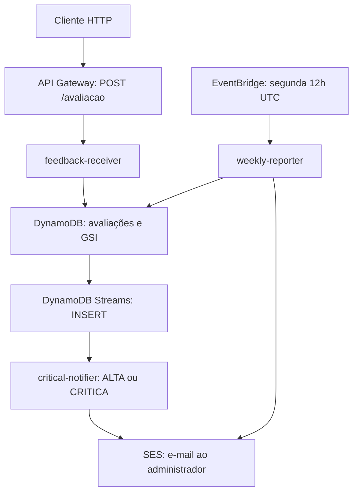

# Arquitetura

[Voltar ao README](../README.md)

## Visão e fronteira

A solução processa avaliações de cursos on-line com funções independentes e serviços gerenciados da AWS. O código compartilhado está em `common`; cada função produz seu próprio JAR. Não há frontend ou servidor Spring Boot neste repositório. O diagrama representa os fluxos implementados nos handlers e as integrações declaradas no SAM.

A resposta HTTP é síncrona apenas até a persistência. Notificação e relatório têm gatilhos próprios; não aumentam a responsabilidade do endpoint. CloudWatch, SNS e IAM complementam a operação, conforme o template.

## Componentes e decisões

| Componente | Decisão e consequência |
|---|---|
| AWS Lambda | Uma função para recebimento, uma para alerta e uma para relatório; execução sob demanda. Cold start, timeout e reprocessamento precisam ser considerados |
| API Gateway REST | Expõe `POST /avaliacao` por integração proxy com Lambda |
| DynamoDB | Persistência gerenciada por chave `id`; consultas semanais usam GSI, evitando `Scan` |
| DynamoDB Streams | Desacopla gravação e alerta; o handler processa inserções e seleciona urgência alta/crítica |
| EventBridge | Disparo semanal declarado no SAM; o período efetivo é calculado pelo relógio UTC da aplicação |
| SES | Adaptadores implementados para e-mails de alerta e relatório; requer identidades verificadas e permissões |
| SNS | Tópico declarado para alarmes CloudWatch; adaptador de alerta de negócio ainda não implementado |
| SAM/CloudFormation | Descrição versionada de recursos e parâmetros de implantação |

## Organização interna

Pacote base: `br.com.fiap.techchallenge.fase4`.

| Camada/pacote | Elementos | Responsabilidade |
|---|---|---|
| `domain` | `Avaliacao`, `Urgencia`, estatísticas e serviços de cálculo | Regras de urgência, média e agrupamentos |
| `application` | DTOs, validação, casos de uso e portas de saída | Orquestrar recebimento e relatório e definir contratos com adaptadores |
| `infrastructure` de `common` | Clientes AWS, repositório DynamoDB e JSON | Implementar persistência e utilitários compartilhados |
| Módulos Lambda | Handlers, configurações e adaptadores SES | Traduzir eventos e montar dependências |

A solução utiliza portas e adaptadores em parte de sua estrutura. O recebimento usa `ReceberAvaliacaoUseCase`; o relatório usa `GerarRelatorioSemanalUseCase`. O alerta atualmente orquestra o fluxo no próprio handler e instancia `SesNotificacaoService`; `ProcessarNotificacaoCriticaUseCase` e `CriticalNotifierConfig` permanecem em TODO e não participam desse caminho. Não se deve descrever essa separação como totalmente uniforme.

O módulo `common` contém tanto domínio quanto adaptadores AWS. Essa escolha reduz duplicação no projeto acadêmico, mas mantém acoplamento de dependências entre funções.

## Persistência

Fonte: `AvaliacaoEntity`, `AvaliacoesTableSchema`, `DynamoDbAvaliacaoRepository` e template SAM.

| Atributo | Tipo DynamoDB | Significado |
|---|---|---|
| `id` | S | Chave primária, UUID gerado pela aplicação |
| `descricao` | S | Texto informado pelo cliente |
| `nota` | N | Nota entre 0 e 10 |
| `urgencia` | S | Classificação calculada |
| `dataEnvio` | S | Instant serializado como texto ISO-8601 |
| `entityType` | S | Valor `AVALIACAO`, chave de partição do GSI |

O GSI `periodo-index` possui PK `entityType`, SK `dataEnvio` e projeção `ALL`. O repositório pagina os resultados da consulta por período. O relatório aplica filtro temporal adicional para excluir o início da semana seguinte, já que a consulta do repositório usa intervalo inclusivo.

O template declara tabela `${EnvironmentName}-avaliacoes`, cobrança `PAY_PER_REQUEST`, SSE, Point-in-Time Recovery e Stream `NEW_IMAGE`. Esses recursos precisam ser confirmados na stack implantada. A partição fixa do GSI e a materialização do relatório em memória devem ser reavaliadas se houver alto volume.

## Segurança e observabilidade

- IAM: roles separadas para escrita da avaliação, consumo de stream/envio de alerta e leitura/envio do relatório. As permissões SES usam `Resource: '*'` no template; revisar escopo antes de alegar privilégio mínimo completo.
- API: não há authorizer, exigência de API key ou autenticação configurada no template atual. CORS também não é configurado pela fábrica de respostas.
- Configuração: nomes de tabela e e-mails chegam por variáveis/Parameters do SAM. Não há busca de segredos implementada em `SecurityConfig`.
- Logs: handlers usam SLF4J; `CloudWatchMetricsService` registra contadores e valores como texto. Não publica métricas customizadas por `PutMetricData`.
- Infraestrutura: alarmes usam a métrica nativa `AWS/Lambda Errors`; o dashboard declara invocações e erros. Erros HTTP tratados e retornados como `500` não necessariamente incrementam `Lambda Errors`.
- Privacidade: os helpers de máscara permanecem em TODO; não afirmar que descrições e erros estejam automaticamente anonimizados.

## Falhas e consistência

O `201` significa que o repositório recebeu uma gravação bem-sucedida, não que um e-mail foi entregue. Não existe chave de idempotência no recebimento: repetir uma requisição cria outra avaliação. No consumidor do stream, exceções de conversão ou SES interrompem o lote e propagam para a Lambda. A infraestrutura não declara DLQ, destino de falha ou resposta parcial de lote; políticas de retry e tratamento de registros problemáticos precisam de revisão operacional.

Não há deduplicação persistida para notificações ou relatórios. Reprocessar eventos pode repetir e-mails. O relatório usa a data da execução, não o campo `time` do evento: uma reexecução tardia em outra semana pode selecionar outro período.

## Fontes de implementação

- [SAM](../infrastructure/template.yaml)
- [Recebimento](../feedback-receiver/src/main/java/br/com/fiap/techchallenge/fase4/feedback/handler/FeedbackReceiverHandler.java)
- [Alerta](../critical-notifier/src/main/java/br/com/fiap/techchallenge/fase4/notifier/handler/CriticalNotificationHandler.java)
- [Relatório](../weekly-reporter/src/main/java/br/com/fiap/techchallenge/fase4/report/handler/WeeklyReportHandler.java)
- [Casos de uso](../common/src/main/java/br/com/fiap/techchallenge/fase4/application/usecase)
